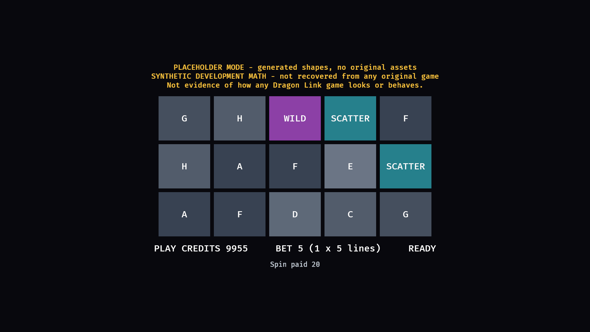

# dragonlink-decomp

[](https://github.com/bailo167/dragonlink-decomp/actions/workflows/ci.yml)


**An evidence-driven preservation and reimplementation project for Aristocrat's classic Australian
*Dragon Link* games, written from scratch in Rust and Bevy.**

> **Work in progress, and a preservation project.** Almost nothing about the original games is
> reproduced yet. What runs today runs on a **synthetic development fixture** invented by this project;
> it is not Dragon Link's mathematics, artwork or sound, and nothing here claims otherwise.
>
> **Unofficial.** Not affiliated with, endorsed by, or connected to Aristocrat Leisure Limited or
> Product Madness. This repository contains **no proprietary game software, assets or data**.
> It is not for real-money gambling and is not designed to run on, connect to or interfere with
> any gaming machine. Credits are simulation credits and stand for no money.

## Two end-states

1. **Parity**: reproduce the games' observable behaviour in Rust and Bevy.
2. **Understanding**: recover the games' mathematics well enough to explain, quantitatively and
   from evidence, how each version behaves, and to tell myth from configuration difference from
   genuine expected-value difference. See
   [docs/reverse-engineering/math/](docs/reverse-engineering/math/README.md).

## The four titles

| # | Title | State |
|---|---|---|
| 1 | **Dragon Link — Golden Century** | **Current target.** The first complete vertical slice. |
| 2 | Dragon Link — Happy & Prosperous | After Golden Century. |
| 3 | Dragon Link — Panda Magic | After Golden Century. |
| 4 | Dragon Link — Autumn Moon | After Golden Century. |

The long-term aim is a 1:1 recreation wherever evidence permits: presentation, reels, symbols, sound,
timing, pay evaluation, Hold & Spin, free games, jackpots and attract behaviour. Where there is no
evidence, the behaviour stays marked unknown. It is not filled in to look finished.

## What exists today

- **A deterministic, render-free game core** (`dragonlink-core`): bet, spin, reel window, line and
  scatter pays, a Hold & Spin respin loop, credit accounting, all as a state machine that turns commands
  into events. It runs under an injected outcome source so games can be recorded and replayed exactly.
- **A data model that keeps evidence and invention apart** (`dragonlink-model`): a claims database in
  which every statement about the originals carries a confidence label, a source class and a citation,
  with the rules enforced by tests, and a separate, clearly labelled synthetic math fixture for engine
  development.
- **A Bevy application shell** (`apps/dragonlink`) that drives the real simulation in an obvious
  placeholder mode: generated cells, generic symbol names, a banner saying what it is. It builds on
  Windows in debug and release, compiles for the web, and has an unattended smoke run.
- **A mathematics analysis subsystem** (`dragonlink-math`, `dragonlink-analyze`): given a game
  configuration it computes the return and its composition exactly, the Hold & Spin trigger
  probability and outcome distribution, jackpot frequencies, hit frequency by full enumeration,
  expected value as a function of jackpot meters, and the differences between two configurations,
  with a seeded simulation as an independent cross-check. Every constant carries its provenance.
  It has only the synthetic fixture to work on so far.
- **A first evidence base**: 99 sourced, machine-checked claims and the research documents behind
  them. Regulators' records establish the four titles' Australian approval identities and platform
  generations; the manufacturer's own court filing gives the Hold & Spin rules.
- **Guard rails**: a hygiene checker that refuses game packages, cabinet images, extracted assets,
  decompiler output and credentials; a progress tracker that refuses "implemented" without evidence;
  a Windows pre-merge gate; CI.

What does **not** exist yet: any original mathematics (none is public; the manufacturer treats it
as a trade secret), any original asset, the importer, anything title-specific on screen, and any
parity measurement. See [docs/STATUS.md](docs/STATUS.md) for the current state in
detail and [docs/BLOCKERS.md](docs/BLOCKERS.md) for what is waiting on something external.



*The application today, in placeholder mode. Generated shapes and a synthetic fixture: not Dragon Link's artwork, symbols or mathematics.*

## Progress

Generated from [`progress/progress.toml`](progress/progress.toml), the single source of truth.
"Implemented" means our code exists and is tested. "Verified" means it has been shown to agree with
evidence about the original. Compiling, passing our own tests or looking right never counts as verified.


<!-- progress-table:start -->
<!-- generated by `cargo run -p progress-gen`; do not edit by hand -->

| Category | Items | Implemented + verified | Verified | In progress | Completion | Verified % |
|---|---:|---:|---:|---:|---:|---:|
| Foundation | 10 | 9 | 0 | 1 | 90% | 0% |
| Reverse engineering | 13 | 3 | 0 | 8 | 23% | 0% |
| Mathematics and analysis | 30 | 11 | 0 | 13 | 36% | 0% |
| Shared game runtime | 19 | 9 | 0 | 10 | 47% | 0% |
| Golden Century | 15 | 4 | 0 | 9 | 26% | 0% |
| Happy & Prosperous | 15 | 1 | 0 | 11 | 6% | 0% |
| Panda Magic | 15 | 1 | 0 | 11 | 6% | 0% |
| Autumn Moon | 15 | 1 | 0 | 11 | 6% | 0% |
| Genghis Khan | 15 | 0 | 0 | 13 | 0% | 0% |
| Golden Gong | 15 | 0 | 0 | 13 | 0% | 0% |
| Peace & Long Life | 15 | 0 | 0 | 13 | 0% | 0% |
| Spring Festival | 15 | 0 | 0 | 13 | 0% | 0% |
| Parity | 10 | 5 | 0 | 4 | 50% | 0% |
| Platforms | 4 | 0 | 0 | 4 | 0% | 0% |
| Packaging | 5 | 1 | 0 | 3 | 20% | 0% |
| **Overall** | **211** | **45** | **0** | **137** | **21%** | **0%** |

<!-- progress-table:end -->

## How evidence is handled

Every substantive statement about the original games is labelled
**VERIFIED**, **STRONG EVIDENCE**, **PARTIAL**, **HYPOTHESIS**, **UNVERIFIED LEAD** or **UNKNOWN**, and
records where it came from: cabinet software, regulatory documents, official mobile software, official
media, gameplay recordings, third-party observation, or our own conjecture.

Two rules matter most:

1. **Official mobile software is evidence for presentation, not for cabinet mathematics.** Artwork,
   sound, animation and UI can be studied there. Reel strips, weights, RTP, jackpot odds and feature
   frequency are not assumed to match the Australian cabinet game.
2. **Synthetic is never passed off as recovered.** The engine needs numbers to run, so it has a
   fixture with generic symbols named `A` to `H`. Every trace and every screen produced from it says so.

The full policy is in [docs/EVIDENCE.md](docs/EVIDENCE.md).

## Source material is yours, and stays local

The project is built so that someone with legitimately obtained source material can keep it in a
private folder **outside** the repository, inventory it, import it into a normalised local asset set,
and build a complete private copy, without any of it entering Git.

```
legitimately obtained source material  (private source root, outside Git)
        │  inventory / inspect
        ▼
     importer  ──►  normalised local asset set + manifest  (also outside Git)
                                │
                                ▼
                     Rust / Bevy runtime
```

Without source material the project still builds, tests and runs in an obvious placeholder mode.
See [docs/SOURCES.md](docs/SOURCES.md).

## Architecture in one screen

| Crate | Role |
|---|---|
| `crates/dragonlink-model` | Evidence labels, the claims database, symbols, layouts, runnable math models, the synthetic fixture. |
| `crates/dragonlink-core` | The deterministic simulation: state machine, pay evaluation, Hold & Spin, events, outcome sources. No rendering, no files, no clock. |
| `crates/dragonlink-math` | Mathematics analysis of a game configuration: exact, simulated, comparative. |
| `tools/dragonlink-analyze` | `analyze-game`, `compare-games`, `progressive-ev`, `simulate`. |
| `crates/dragonlink-formats` | Identify files by content, measure entropy, list ZIP-family packages. |
| `tools/dragonlink-inventory`, `tools/dragonlink-inspect` | Create and check the private source root; hash and classify source material; measure one unknown file. |
| `apps/dragonlink` | The Bevy application. Placeholder mode only so far. |
| `crates/dragonlink-trace`, `tools/dragonlink-trace` | The behavioural trace format, recording, comparison, replay of observed outcomes through the simulation, and conversion of transcribed windows into observation traces. |
| `tools/dragonlink-capture` | Finds the moment each game in a recording came to rest and cuts a still of it, for transcription. |
| `crates/dragonlink-assets` | The asset manifest: ids, provenance, hashes, verification, discovery. |
| `tools/dragonlink-import`, `tools/dragonlink-pack` | Import your own source material into a local asset set; verify it; assemble a local package. |
| `tools/progress-gen` | Validates the tracker and renders the progress matrix and table above. |
| `tools/repo-hygiene` | Refuses proprietary material, dumps, secrets and private paths. |

The importer reads standard media that is loose or inside ZIP-family archives. Planned and tracked:
unpacking other containers, converting and identifying assets, and showing imported assets in the
application. The application also builds for the browser (`tools/dev/web.ps1`), in placeholder mode.
The application presents simulation events; it never decides an outcome or computes an award.
Details: [docs/ARCHITECTURE.md](docs/ARCHITECTURE.md).

## Quick build

Requires Rust 1.98 (pinned in `rust-toolchain.toml`; `rustup` installs it automatically).

```sh
cargo test --workspace                                   # everything headless
cargo run -p dragonlink                                  # the application, placeholder mode
cargo run -p repo-hygiene                                # nothing proprietary in the tree
cargo run -p progress-gen -- --check                     # tracker valid, generated files fresh
```

Analyse the built-in synthetic fixture (it describes no real game):

```sh
cargo run --release -p dragonlink-analyze -- analyze-game synthetic --simulate 1000000
cargo run --release -p dragonlink-analyze -- progressive-ev synthetic --meter grand=25000
```

On Windows the full pre-merge gate is one command:

```powershell
powershell -NoProfile -ExecutionPolicy Bypass -File tools\dev\gate.ps1
```

More in [docs/BUILDING.md](docs/BUILDING.md).

## Documentation

| Document | What it covers |
|---|---|
| [docs/STATUS.md](docs/STATUS.md) | Where the project is right now and what is next. |
| [docs/ROADMAP.md](docs/ROADMAP.md) | The staged path for Golden Century and the other titles. |
| [docs/ARCHITECTURE.md](docs/ARCHITECTURE.md) | Crates, boundaries and the rules that keep them apart. |
| [docs/EVIDENCE.md](docs/EVIDENCE.md) | Confidence labels, source classes and the provenance rules. |
| [docs/SOURCES.md](docs/SOURCES.md) | The private source root, what may be acquired, and how it is handled. |
| [docs/PARITY.md](docs/PARITY.md) | How agreement with the original will be measured. |
| [docs/BUILDING.md](docs/BUILDING.md) | Toolchain, the Windows host, the gate. |
| [docs/DECISIONS.md](docs/DECISIONS.md) | Architectural decisions and why they were made. |
| [docs/BLOCKERS.md](docs/BLOCKERS.md) | Genuine external blockers only. |
| [docs/PRIOR_ART.md](docs/PRIOR_ART.md) | What was carried over from ASAMU-decomp and learned from other projects. |
| [docs/LEGAL.md](docs/LEGAL.md) | Scope, what is and is not in the repository. |
| [docs/reverse-engineering/](docs/reverse-engineering/README.md) | The research knowledge base. |
| [docs/reverse-engineering/math/](docs/reverse-engineering/math/README.md) | The mathematics lane: method, provenance, configuration format, questions. |

## Legal

This is an unofficial software preservation and study project. *Dragon Link*, *Golden Century*,
*Happy & Prosperous*, *Panda Magic*, *Autumn Moon*, *Hold & Spin* and related names and marks belong to
their respective owners. No proprietary software, artwork, audio, fonts or data are distributed here;
users supply their own legitimately obtained source material. The project is not intended for
real-money gambling, has no functionality for connecting to jackpot networks or gaming equipment, and
uses simulation credits only. Full statement: [docs/LEGAL.md](docs/LEGAL.md).

The code is dual-licensed under [MIT or Apache-2.0](LICENSE), at your option.
